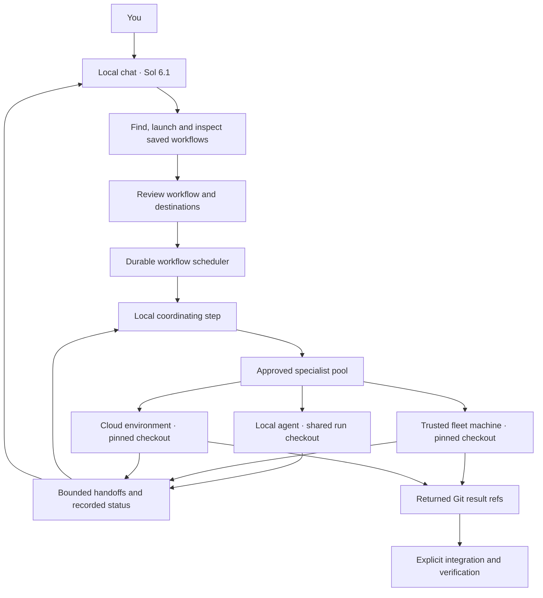
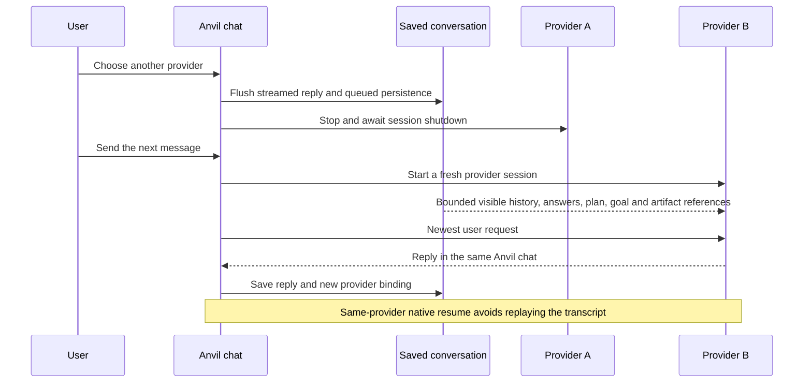
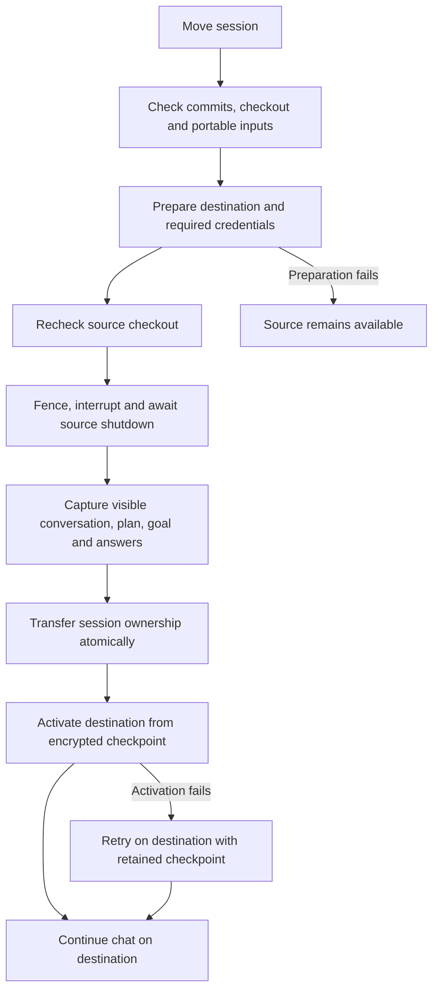

# Chat context, environments and orchestration

Reviewed against the desktop implementation on 18 October 2026. This describes Anvil Mesh and the desktop workflow runner. The separate `anvil-cloud` framework and its legacy execution connection have different contracts.

## Running Sol 6.1 locally and delegating elsewhere

Yes, a local chat can coordinate work on other machines through a saved Anvil workflow. Select Sol 6.1 from the models available through your configured provider. The provider/model chooses the agent; the execution destination chooses where its tools and files live.

In Workflows, configure a coordinating step with autonomous delegation and an approved specialist pool. Each specialist has a persona, provider, model, capabilities and execution destination. Destinations include this device, a trusted fleet device, automatic placement by capability, an existing cloud environment, or a new cloud environment with a lifetime. Save the workflow before asking the agent to use it.

For example, ask the local chat: "Use my Release checks workflow to delegate the Linux packaging check to my build machine and an independent review to the cloud specialist. Keep me updated and report their evidence."

The agent calls `workflow_list`, then `workflow_start`. Anvil presents the saved workflow and its destinations for approval. The run receives the chat's selected repositories, bounded conversation context and access ceiling. It continues independently of the coordinating chat. The agent can use `workflow_read` to inspect durable status and results, including after reconnecting. Completion or a human decision is also reported to the originating live session when available. Stopping that chat does not cancel an already launched workflow; use the workflow's Stop control.

The scheduler owns dependencies, concurrency, node count, delegation depth, attempts and the run deadline. A coordinating agent requests children by approved profile ID using an `anvil-delegate` response. Anvil validates the request, expands the graph, runs the children and resumes the coordinator with their handoffs. Remote children complete their assigned task; recursive coordination stays local. Fixed map/reduce, review and debate teams use the same runner. Chat's Parallel or Adaptive setting is provider-native execution within that session; it does not itself place jobs across the fleet.

Remote workflow steps currently support Codex, OpenAI and Azure. Local workflow steps support all six desktop providers. Remote chats have a broader provider matrix and support Codex, OpenAI, Azure, Cursor, Devin and LLMGateway. A remote destination needs trust, remote work enabled, repository access and provider credentials. A cloud destination also needs a configured environment provider and an enrolled worker. The destination's access ceiling can further restrict the requested mode.

## What crosses a provider boundary

Anvil's saved chat is the canonical visible conversation. A provider's native thread handle belongs to that provider and host. Changing providers never passes one provider's handle to another.

Fresh saved sessions receive up to 40 recent user/assistant messages, the saved summary, resolved question answers, active plan and goal, and artifact metadata. Sensitive question answers are redacted. The prompt checkpoint has a 32,000-character budget; each message is capped at 6,000 characters. It explicitly distinguishes prior conversation from current instructions and repository evidence. The first accepted turn consumes that checkpoint; subsequent turns use the provider's native context.

Activity and tool-log entries do not displace the visible conversation. Assistant responses stored as event entries are included by role. Temporary chats do not import saved history. Native resume and fork retain their provider history without an extra transcript replay. Switching back after a different provider has replaced the binding starts a fresh session from the current canonical chat.

This transfers visible context, not hidden reasoning, authentication, native tool state or artifact files. The checkpoint supplies artifact IDs and paths so the agent can locate available material. Session-local artifacts and attachments are not automatically copied to another machine. Long histories remain bounded and can omit older details, so decisions that must survive a long session belong in the saved plan, goal or repository documents.

Optional on-device replies also receive recent conversation context. When that context exceeds the small on-device prompt budget, the configured main provider handles the turn. After an on-device answer, Anvil flushes its saved reply and refreshes the main provider's context on the next turn, even when reusing that provider's live session. It clears the stale saved native handle so a restart also continues from canonical chat history.

## Moving the whole chat

Moving a chat is different from delegating a task. The destination takes ownership of the agent session. The source becomes its controller and shows remote activity, approvals and follow-up controls.

Readiness requires clean tracked files, an explicit policy for untracked inputs and reachable commits. Unsupported repository shapes fail before transfer. Preparing the target happens before stopping the source. The source's durable ownership fence prevents it from continuing after transfer. Once ownership has transferred, recovery proceeds on the destination rather than reviving a second writer. The checkpoint carries the pre-stop provider and model, both plan and goal, saved answers, artifact references and recent visible conversation. Prior approval authority is not transferred.

Same-device remote follow-ups reuse a verified native provider handle. Cross-device moves use the checkpoint. Exact sealed requests and job identities survive retries, preventing a lost network response from silently launching duplicate work. Existing remote chats keep their original provider, model and destination; start a new chat to choose different ones. Returning an active remote chat directly to local execution is not implemented.

## Repository and result boundaries

Remote workflow jobs use the run's frozen repository commits. Before a new dispatch, Anvil checks that the source checkout still matches those commits and has no tracked or untracked edits. A mismatch stops the step with instructions to commit and start a new run, or keep the step local. This check happens before provisioning an environment. Reattaching an already submitted request retains its original snapshot.

Workflow edges transfer reports, not another worker's working directory. A downstream remote step does not automatically test an upstream worker's code changes. Keep code-dependent edits and tests within the same remote task, or integrate the result before starting the next run. Local concurrent agents share the run checkout and must avoid conflicting edits.

Remote results are fetched into result refs, leaving the user's checkout untouched. Use the workflow's explicit integration action to combine those branches in an integration worktree and run the configured verification. Conflicts require attention. A completed worker report alone does not mean the changes were integrated, tests independently passed, or anything was pushed or deployed.

## Verification and remaining limits

The local suite covers context bounds, visible assistant history, saved and sensitive answers, native resume, on-device continuity, remote checkpoint capture, source snapshot checks, workflow handoffs, target validation, permission ceilings, scoped agent tools, launch approval and cancellation. The desktop suite passed 2,843 tests with 12 skipped during this review. Both TypeScript checks, lint, the Electron build and daemon build also passed.

An isolated native Electron session passed Sol 6.1 → Cursor → Sol 6.1. Cursor recalled the original synthetic project code and layout; Sol then recalled Cursor's updated layout and the earlier choice it replaced. Workflow discovery reached the saved template, and launch correctly refused an empty repository selection before approval or dispatch. Specialist destination persistence, multiple capability entry, unsupported-provider restrictions and cloud loading error/retry were also checked in the native app. Final light and dark captures passed independent review for the five destination-control fixes, including labels, focus and error recovery. These local checks do not exercise a real remote worker.

Remote interactive questions and mid-turn steering are still unsupported; workers fail explicitly when a provider requires an interactive question. Stop, approvals and ordinary follow-up controls have separate supported paths. There is no claim of a live fleet/cloud acceptance pass here. Two physical devices and the deployed cloud images still need the provider-by-provider acceptance matrix recorded in ANV-11, including authentication, disconnect/restart, cancellation and recovery.

Implementation entry points: `chat-continuation.service.ts`, `codex-session.service.ts`, `mesh-handoff.service.ts`, `remote-chat.service.ts`, `workflow.service.ts`, `workflow-runtime.ts`, `workflow-source-snapshot.ts` and `agent-tools/workflow-tools.ts` under `src/main/`.
