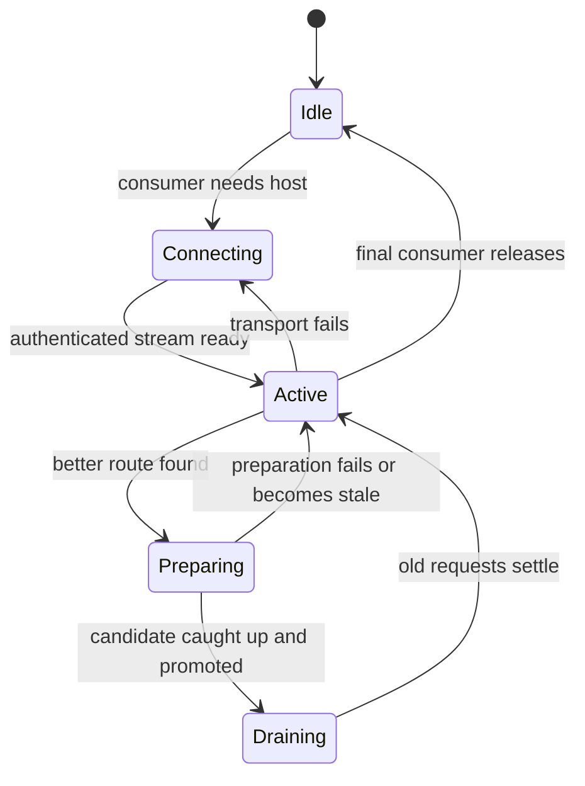

# LAN first connectivity implementation plan

Status: implemented locally, 27 October 2026. Automated verification is recorded below;
physical acceptance and deployment remain pending.

Make Mesh prefer a reachable LAN route, fall back promptly to other private routes or a
managed tunnel, and upgrade an active connection when a better route becomes available.
Desktop, the headless daemon and native mobile account connections are in scope. Reuse the
existing authenticated, encrypted machine WebSocket sessions.

The [decision record](decisions.md) continues to govern trust, execution authority and rollout.
LAN routing does not provide offline Mesh: admission and continuing session authorization
still depend on the configured backend. Authorization refresh remains every 30 seconds with
a maximum authorization age of 60 seconds. Transport selection must preserve those checks.

## Implementation record

The six phases below are implemented in the working tree. Shared contracts now contain the
route policy and bounded probe/authentication scheduler; desktop/daemon and native mobile own
stable sessions with separate active, preparing and draining connections. The host advertises
`machine.stream-handoff/1`, orders replay before its completion marker and retires sessions when
their owning socket closes. Network changes refresh advertised addresses and active discovery.
Desktop and mobile connection details expose the selected, authenticated path.

Integration details that refine the plan:

- `machine.routes-changed` is sent only to account sockets opting in with
  `X-Anvil-Socket-Features: machine.routes-changed/1`. Older clients reject unknown frame types,
  so emitting this additive hint to every existing socket would disconnect them. Hints are
  coalesced for 150 ms and contain enrollment IDs only. Periodic discovery covers missed hints.
- The shared scheduler reserves a fallback probe lane after the 250 ms head start. Its deadlines
  also settle adapters that ignore cancellation; late authenticated connections are closed.
- Sign-out immediately blocks outbound sessions and advertisements before awaiting backend
  revocation. Mobile account persistence is serialized and generation-fenced so a delayed refresh
  cannot restore a signed-out session. Buffered events and pending responses recheck scope before
  reaching consumers.
- iOS configuration declares local-network usage and permits local networking without arbitrary
  loads. The maintained Android Expo plugin enables cleartext transport for dynamically discovered
  private IPs, which static domain rules cannot enumerate. URL restrictions still apply, broker
  credentials require HTTPS, and machine traffic remains authenticated and end-to-end encrypted.
  Generated configuration checks do not prove physical permission or release-build behavior.
- A `Direct` label means a validated host LAN-address hint; it does not claim that the operating
  system selected a physical LAN route. Unknown interfaces remain `Private Network`.

The phase descriptions retain the implementation requirements and acceptance criteria. The
baseline table describes the code inspected before this change, not the implemented state.

## Intended behavior

- Two enrolled devices on a reachable LAN use that route without manual address entry.
- Unreachable private addresses do not each add a ten-second delay before tunnel fallback.
- Joining the host's LAN upgrades an active tunnel/private-network session after a replacement
  has authenticated and caught up with the event stream. Failed preparation leaves the
  working connection serving requests.
- Leaving the LAN reconnects through another usable route. A broken connection cannot provide
  make-before-break continuity; the UI reports reconnection and existing uncertain-command
  behavior remains visible.
- Address changes on the host refresh discovery promptly. Desktop wake and mobile foreground
  return trigger reassessment. Repeated network changes do not create connection flapping.
- Connection details expose the selected path without displaying endpoint URLs or credentials.
- Idle clients do not open sessions or perform remote probes just because a host is discoverable.

Fully offline authorization, new peer discovery protocols, IPv6-only listener support and
automatic execution migration between machines are separate work. The browser dashboard keeps
its permitted HTTPS routing. The manually paired companion API keeps its own transport policy.
Raycast receives low-level route-selection improvements and regression coverage, but persistent
session migration is limited to desktop/daemon and native mobile in this change.

## Baseline implementation and gaps

Paths below are relative to `anvil-app/`.

| Area | Existing behavior | Required change |
| --- | --- | --- |
| `src/main/services/mobile-companion.service.ts` | Enumerates IPv4 interfaces; appends loopback; publishes at startup/lifecycle changes and every ten minutes. The default listener is `0.0.0.0:47631`. | Normalize and monitor interfaces; publish changed routes promptly. Keep the existing advertisement refresh as a TTL heartbeat. |
| `cloud/backend/src/hosted/machine-api.ts` | Converts every companion endpoint into a `private` machine route. | Preserve validated preference hints and exclude remote loopback candidates. |
| `cloud/backend/src/account-coordinator.ts` | `device.advertise` stores endpoints without emitting a discovery invalidation. | Notify account clients when the effective route set changes. |
| `src/main/services/mesh-host-client.service.ts` | Orders `private`, `https`, then `managed`; connects sequentially; each HTTP call has a ten-second timeout. | Separate bounded reachability probes from authenticated session creation. |
| `src/main/services/mesh-host-runtime.service.ts` | Reuses a healthy connection and reconnects retained consumers after failure. | Own active/candidate/draining connections, cursors, migration and retry policy. |
| `mesh-host-session.service.ts` and `mesh-host-session-server.service.ts` | Subscribe acknowledges before replay; live events can interleave with replay. Closed sockets leave session records until expiry. | Establish ordered replay completion and prompt, ownership-aware session retirement. |
| `mobile/lib/mesh-session.ts` and `mobile/lib/anvil-api.ts` | Cache concrete connections and attach consumers/reconnect timers directly to sockets. | Add a stable host-session manager and native network adapter. |

The host's advertisement comment suggests Tailscale-first ordering, but actual enumeration
preserves OS interface order. The companion base URL's LAN preference is a separate code path.
Neither establishes explicit LAN priority for Mesh.

## Phase 1 — Route metadata and bounded selection

Extend `MeshMachineRoute` in `cloud/contract/machine.ts` with optional
`networkKind: 'lan' | 'private-network' | 'loopback'` for private routes. Keep the existing
`kind` values and machine protocol version. Add a validated optional `meshNetworkKind` field
to `CompanionEndpoint` in `cloud/contract/companion.ts`, accepting those three values plus
`unknown`. Carry it through host address enumeration, advertisement and broker projection;
this lets an uncertain interface retain its classification without changing the existing
companion `kind` enum or its transport policy.

Project a valid explicit hint into the machine route. Treat legacy `lan` advertisements
without this field as unspecified private routes; recognize validated loopback addresses
and the private-network classification of legacy Tailscale candidates separately. Unknown
or inconsistent hints normalize to an unspecified private route, never to a more permissive
URL policy. Host/interface classification remains a preference heuristic, not OS route proof.

Add a platform-neutral `cloud/contract/machine-route-policy.ts` for validation of hint values,
normalization, deduplication, ranking and cooldown decisions. Desktop and mobile use the same
policy tests; platform-specific fetch, cryptography and sockets stay in their existing clients.

Selection order is LAN candidate, other/unspecified private network, explicit HTTPS, then managed
tunnel. Within a tier, prefer a recently successful route for the current network generation.
Preference metadata is a hint, not proof of locality, identity or authorization. A private IP
can belong to a VPN, and a reported `100.*` address is not sufficient evidence of Tailscale.
Correct the current address classifier to recognize `100.64.0.0/10` rather than all of `100/8`;
retain an unknown/private classification when the interface cannot be identified confidently.

Remove loopback from cross-machine Mesh discovery and reject it again in remote-client route
selection, including legacy routes without a hint. Keep loopback available to the explicit
same-machine companion path. Normalize and deduplicate valid advertised interfaces before
applying `COMPANION_MAX_ENDPOINTS` (eight), retaining a deterministic useful set. Do not invent
addresses or scan subnets.

Refactor connection establishment into two stages:

1. Probe only broker-advertised, fresh, generation-matched routes using the existing read-only
   machine info endpoint. Keep redirect rejection, origin validation and bounded response bodies.
   The probe sends no account bearer, admission ticket or application command. Its reported
   identity must match discovery, but remains untrusted until session authentication succeeds.
2. Authenticate a selected viable route with the existing ticket, identity proof and fresh
   traffic keys. Allow only one authentication attempt per host at a time; do not race admission
   tickets across every address. On route failure, try another viable candidate within the
   connection budget. Abort superseded probes and close abandoned candidate sessions.

Initial named tuning constants, injected into tests:

| Control | Initial value |
| --- | --- |
| Preferred-route head start | 250 ms before lower-priority probe work becomes eligible |
| Private info probe deadline | 1 second |
| HTTPS/managed info probe deadline | 2 seconds |
| Probe concurrency | At most three per host and eight per client runtime |
| Authentication concurrency | One per host and four per client runtime |
| Authentication attempt deadline | 20 seconds total, retaining tighter existing per-operation limits |
| Initial connection attempt budget | 30 seconds after dispatch; cancel all remaining work at expiry |
| Complete upgrade preparation budget | 30 seconds after dispatch, including probe, authentication, subscription and catch-up |

Reserve probe capacity for fallback once its head start expires, so several dead LAN addresses
cannot starve a reachable tunnel. After the head start, choose the highest-ranked successful
probe available; do not wait for every preferred address to time out. A later LAN success can
use the normal upgrade path. Queue hosts fairly under global limits. Recheck expiry and scope
before authentication, rather than relying on the time captured when discovery began.

Acceptance: deterministic route ordering, bounded tunnel fallback, no leaked credentials on
probes, cancellation of losing work and correct behavior for malformed/expired/duplicate routes.

## Phase 2 — Network changes and discovery propagation

Add `src/main/services/mesh-network.service.ts`, using injected interface enumeration, clock
and lifecycle callbacks. Both desktop and daemon start it through the shared Sync runtime.
Fingerprint sorted interface addresses, families and netmasks; avoid changes caused only by
enumeration order. Sample every 15 seconds while the signed-in host listener is active or an
outbound Mesh consumer exists. Local enumeration alone must not trigger backend writes.

On a changed fingerprint, debounce for 500 ms, increment the local network generation, cancel
obsolete probes, publish the normalized host advertisement and refresh active-client discovery.
Do not rotate machine identity or endpoint generation solely because an IP address changed.
If publication fails, keep a dirty revision and retry with bounded backoff; only the latest
revision may clear it. The existing ten-minute TTL refresh remains in place. Scope changes,
sign-out and shutdown cancel obsolete publishing work.

Extend `cloud/contract/socket.ts` with `machine.routes-changed`, carrying the usual version/id
and affected enrollment ID. In `handleDeviceAdvertise`, compare normalized effective route
metadata, machine identity/generation and removal against the previous record. After the
successful commit, emit one account-scoped hint when that effective value changes. Do not emit
for identical heartbeat refreshes. Coalesce bursts per host and keep addresses out of the frame.

Teach `sync-backend-client.service.ts` and `sync-runtime.service.ts` to accept the hint and
coalesce discovery refreshes. This event does not grant worker execution or start a Sync upload.
New hints arriving during an outstanding refresh must schedule a follow-up for the newest
revision, rather than disappearing behind `refreshInFlight`.

Reuse desktop `onSystemResume` and account-channel reconnect to request an immediate network
sample, advertisement reconciliation and discovery refresh. The daemon's local sampler supplies
the equivalent without relying on Electron events. Active clients also refresh discovery and
recheck better routes at most once every 60 seconds with jitter, covering missed hints and
routing changes that leave interface addresses unchanged. Coalesce this with existing work;
do not add per-consumer roster requests. Mobile uses this bounded fallback even when it has no
account live-channel subscription.

Acceptance: an IP change reaches a connected peer without waiting ten minutes; unchanged
interfaces produce no new advertisement traffic; failed publication and concurrent refreshes
eventually reconcile the newest address set.

## Phase 3 — Ordered stream readiness and session cleanup

Safe migration requires a stronger readiness guarantee than the current socket `ready` frame.
Add a host capability, `machine.stream-handoff/1`, to advertise the following subscribe behavior:

1. A newly authenticated session receives no live broadcasts until a subscription is installed.
2. Capture replay and its watermark for the requested workspace scope, and queue subsequent
   matching live events while the replay batch is written.
3. Send replay frames in order, then the existing response envelope with
   `result: { cursor, replayComplete: true }`, then queued live events in order.
4. Bound queued replay/live data by both bytes and event count. Overflow produces an explicit
   resnapshot requirement or terminates preparation; it must not silently discard events.

Serialize the subscription transition and outbound event stream, without serializing all
long-running application commands. Ensure client inbound decoding/dispatch preserves frame
order, including asynchronous mobile cryptography. Add request correlation and a deadline for
the subscribe-completion response. Session preparation resolves only after that barrier has
been processed. An older host's early subscribe response must never count as replay completion;
automatic migration is disabled when the capability is absent.

Replace the low-level global cursor map with manager-owned delivered-cursor state keyed by
pinned backend identity, account, source enrollment, target enrollment/machine, endpoint
generation, stream epoch and subscription scope. Candidate sessions hold private replay state
and cannot advance the application's delivered watermark. Workspace-filtered global sequence
numbers legitimately contain gaps; never require every integer sequence to appear.

Add a single connection terminal transition carrying its cause. Internal socket/protocol/auth
failure must notify the manager exactly once; intentional retirement must not trigger reconnect.
Bind callbacks to a connection token, not just the host's enrollment or the pool generation.

Add explicit host session retirement when the owning authenticated socket closes. Keep
attach/detach ownership tokens in the shared `MeshHostSessionService`: private and managed
ingress use separate server instances, so listener-local socket maps cannot establish global
ownership. Remove session state and erase traffic key material only if the detaching socket
still owns the session; a late close from a replaced socket must not retire a newer owner,
including across ingress listeners. Include failed authentication and abandoned bootstrap
candidates in cleanup. Give never-attached bootstrap sessions a short bounded expiry aligned
with the connection attempt budget, distinct from the one-hour authenticated lifetime.
Preserve durable command receipts independently of transport-session cleanup. Do not raise
the 64-session limit to accommodate leaked records.

Acceptance: replay cannot be overtaken by live events; repeated failed/successful preparations
reclaim socket/session capacity; closing a stale socket cannot invalidate the active session.

## Phase 4 — Desktop and daemon migration

Refactor each `MeshHostRuntimePool` entry into an active connection, at most one preparing
candidate and at most one draining connection. Track in-flight requests per connection. A
stable host entry owns subscribers, accepted cursors, status and demand across socket changes.



Migration algorithm:

1. Probe upgrades only for an actively retained host on a lower-priority route. An isolated
   request uses initial route selection but does not keep background upgrades alive.
2. Capture scope, host identity, endpoint generation, subscription scope, network generation
   and a unique candidate token. Keep the active connection serving requests and events while
   the replacement authenticates with fresh credentials and keys.
3. Subscribe from the delivered cursor into a private candidate buffer, capped at 512 events
   and 2 MiB. Wait for replay completion and for the ordered candidate stream to cover the
   current active stream's delivered watermark. Use the authenticated initial subscription
   checkpoint as the baseline when no application event has yet been delivered, so quiet hosts
   and filtered streams can migrate. The complete preparation deadline covers all stages.
4. In one synchronous promotion step, recheck account/host identity, endpoint and network
   generations, subscription scope, candidate token, active connection identity, candidate
   health and demand. Recheck candidate coverage against the latest delivered watermark in
   that same step. If it no longer covers the active stream, keep preparing within the budget.
   Route new requests to the candidate; discard buffered events at or below the delivered
   watermark and deliver newer ones in order. Ignore further old-stream events.
5. Keep requests already sent on the old connection attached to it. Retire it when they settle
   or reach their existing deadlines. Do not start another upgrade while it is draining.

On replay expiry, epoch change, buffer overflow or candidate route failure, discard preparation
and keep a still-authorized active connection. If that active connection has also failed, enter
ordinary reconnect/resnapshot recovery and report the gap. Authoritative revocation, sign-out
or account/scope replacement invalidates all associated connections immediately.

Never resend a mutation because a route changed or a response was lost. Preserve the existing
`mesh-host-request-uncertain` result and allow the owning operation's durable receipt logic to
reconcile where supported; receipts do not cover every machine operation. If the new connection
fails after promotion, ordinary route selection reconnects with the same no-replay rule.

Allow proactive upgrades only to a strictly better tier. Use a 60-second minimum dwell after
promotion and failed-upgrade backoff of 30 seconds, doubling to five minutes with jitter. A
new network generation invalidates stale route failures; actual active-transport failure bypasses
the dwell period. Preserve bounded demand-based reconnect and idle close behavior. Last-retainer
release cancels preparation; sign-out/stop also clears timers, buffers, route history and cursors.

Acceptance: a working tunnel remains usable throughout failed LAN preparation, promotion does
not duplicate or lose delivered events, and existing requests execute at most once from the
client's transport logic.

## Phase 5 — Native mobile parity

Create a dependency-injected host-session manager under `mobile/lib/`. Move connection ownership,
subscriber lists, request routing, retain/release, reconnect timers and delivered cursors into it.
Update account-mode `anvil-api.ts`, `account-dial.ts` and `companion-context.tsx` to use that stable
facade. Existing listeners must survive promotion without resubscribing in each screen. Preserve
the separately paired companion path.

Fence manager state by the complete account/backend/source identity, rather than target
enrollment alone. `anvil-account.ts` sign-out/account replacement must cancel scoped work. Check
the same identity after discovery, ticket issuance, bootstrap and preparation. Coalesce roster
discovery across overview polling and stream consumers.

Use Expo's SDK-matched `expo-network`, installed from `anvil-app/` with
`pnpm --dir mobile exec expo install expo-network`. A native adapter consumes
`addNetworkStateListener`, samples `getNetworkStateAsync` and `getIpAddressAsync`, and reuses
the existing `AppState` foreground hook. While foreground consumers exist, sample the native
network/IP fingerprint every 15 seconds to catch address changes without a network-type change.
Debounce events and feed the same generation/cooldown policy used by desktop. Network state is
a trigger for probing, not evidence that a host is reachable.

On background entry, cancel probes and retire any preparing candidate; invalidate its token so
a late completion cannot promote. Keep the current authorized session and pending-operation
outcomes under the existing mobile lifecycle. On foreground return, refresh identity/discovery
and validate connection health before resuming upgrades; do not rely on JS timers running while
suspended. Keep Expo IP sampling native-only: its web implementation uses an external public-IP
service and cannot identify the LAN path.

Add `NSLocalNetworkUsageDescription` through maintained Expo configuration and verify generated
iOS settings retain local-network access without broad arbitrary-load exceptions. Verify the
Android release's generated HTTP/WebSocket network-security policy for the existing encrypted
machine protocol. Test denied permission and later re-enablement; a blocked LAN route should
fall back without repeatedly prompting. No Bonjour discovery is introduced.

Platform references: [Expo Network](https://docs.expo.dev/versions/latest/sdk/network/),
[SDK 57 implementation](https://raw.githubusercontent.com/expo/expo/sdk-57/packages/expo-network/src/Network.ts),
[React Native AppState](https://reactnative.dev/docs/appstate),
[Apple local network usage description](https://developer.apple.com/documentation/BundleResources/Information-Property-List/NSLocalNetworkUsageDescription),
and [Android network security configuration](https://developer.android.com/privacy-and-security/security-config#CleartextTrafficPermitted).

Acceptance: mobile subscriptions and pending requests survive successful promotion; foreground
return, account replacement, permission denial and repeated network changes leave no stale
connection or duplicate reconnect owner.

## Phase 6 — Connection details and diagnostics

Extend `src/shared/sync-runtime.ts` and the existing status bridge with a renderer-safe selected
path field and, where useful, migration state. Keep the primary status about connection health;
show route detail alongside it or in its connection details. Use `Direct` for a LAN-hinted
connection, with `Host LAN address` in the details; use `Private Network` for unknown/overlay
routes, `Direct HTTPS` for explicit HTTPS and `Managed Tunnel` for managed ingress. Successful
authentication proves the host, not the physical network path. Reserve an unqualified `LAN`
label for a future adapter that can substantiate actual local routing.

Only update the selected path after authentication and stream promotion. Failed speculative
upgrades must not flash disconnected status. Present backend authorization failure separately
from route unavailability. Mobile's stable facade publishes equivalent status changes.

Diagnostics may record sanitized route class, attempt duration, transition cause and counters.
Keep raw addresses, tickets, tokens and payloads out of UI errors and routine logs. Use counters
to verify that idle clients perform no probes and repeated failures respect backoff. This phase
uses the existing UI/status surfaces and does not require a new settings screen.

## Verification

Extend existing suites before adding a new harness:

| Coverage | Required cases |
| --- | --- |
| Shared route policy and client tests | LAN/private/HTTPS/managed ordering; explicit unknown and legacy advertisement projection; duplicate routes; loopback rejection; stale identity/generation; malformed URLs; bounded parallel probes; prompt managed fallback; abort during every async stage. |
| Backend `presence.test.ts` and `machine-endpoints.test.ts` | Hint projection; eight-endpoint cap; changed/removed routes emit account-scoped hints; unchanged heartbeats do not; no cross-account disclosure. |
| Host session/server tests | No live events before subscribe; replay then completion then live ordering; workspace-filtered sequence gaps; bounded buffering; same-session replacement across private/managed listeners; stale socket ownership; attached and abandoned session cleanup. |
| Runtime tests | Failed upgrade preserves active route; late callbacks cannot clear the winner; inject an event and a scope/network change immediately before promotion; quiet-host/filtered-stream migration; monotonic cursor ownership; drain/preparation deadlines; no mutation replay; dwell/backoff; final release/stop cleanup. |
| Mobile manager/adapter tests | Stable listeners; coalesced discovery; account switching; background during authenticated preparation; foreground reassessment; same-type address change; permission failure; failed promotion; ordered async decoding. |
| Real wire integration | Two loopback route listeners backed by the same host service; simultaneous old/new sessions; events during replay and promotion; pending mutation responses during drain; more than 64 sequential successful/abandoned migrations without capacity leakage. |

Use controlled clocks and injected network results for scheduler tests. Loopback tests verify
protocol/lifecycle behavior, not physical LAN latency or platform permissions. Root Vitest
excludes `mobile/**`; extend mobile's `test:mesh-session` command to execute the manager and
network-adapter tests, and wire that command plus mobile typecheck/lint into the relevant CI job.

Run focused suites during each phase. Before integration, run from `anvil-app/`:

```sh
pnpm test
pnpm exec tsc --noEmit -p tsconfig.node.json
pnpm exec tsc --noEmit -p tsconfig.web.json
pnpm lint
pnpm build:daemon
pnpm build
pnpm --dir cloud/backend test
pnpm --dir cloud/backend typecheck
pnpm --dir mobile test:mesh-session
pnpm --dir mobile typecheck
pnpm --dir mobile lint
```

Validate Raycast's imported desktop client with its existing build and TypeScript checks.
Install dependencies only in the owning project/workspace, never at the monorepo root. Preserve
unrelated working changes and record failures against the tested candidate rather than treating
historical suite counts as current evidence.

### Local verification — 27 October 2026

These checks cover this working-tree implementation, including the existing unrelated working
changes. They are local evidence; no production backend migration or deployment was performed.

| Check | Result |
| --- | --- |
| Full desktop/contract Vitest, `pnpm exec vitest run --maxWorkers=4` | 360 files and 3,312 tests passed; four files and 12 tests skipped. Includes real encrypted loopback wire tests, more than 64 session preparation/retirement cycles, migration races and observer failure recovery. |
| Desktop Node and renderer TypeScript; full `pnpm lint` | Passed. |
| Headless daemon build | Passed. |
| Electron production build, `pnpm build` | Passed, including the Electron native-module rebuild. Native dependencies were left ready for Electron after the Node test run. |
| Raycast TypeScript and extension build | Passed. |
| Full hosted backend suite and typecheck | 44 files and 498 tests passed; typecheck passed. Includes opted-in route hints and legacy socket compatibility. |
| Mobile `test:mesh-session`, typecheck and lint | 36 tests passed; typecheck and lint passed. Includes real encrypted session framing, network/background lifecycle, delayed response ownership and observer recovery. |
| Native Expo configuration introspection | Local-network purpose and ATS local networking enabled; arbitrary loads disabled on iOS. Maintained Android plugin generates `usesCleartextTraffic=true`. |
| Production mobile JavaScript exports | iOS and Android Hermes exports passed after Metro resolution and observer recovery fixes. The final response-ownership guard was subsequently covered by tests/typecheck/lint. These are JavaScript bundles, not native release binaries. |
| `git diff --check` | Passed. |

An unconstrained desktop run alongside both mobile exports and other builds hit five-second
timeouts in existing Git/workspace tests. The complete four-worker rerun above passed without
changing test timeouts or assertions. The first implementation run also found the final-retainer
cancellation bug; its regression now passes while keeping a pending mutation on its original
connection. Cross-reviews additionally covered scope changes during delivery, delayed response
ownership, failed sends, background cancellation and consumer exceptions.

Physical scenarios below have **not been run** for this change. In particular, loopback tests and
generated configuration do not establish MacBook/Mac-mini LAN switching, cellular transitions,
local-network permission behavior or native release acceptance.

## Physical acceptance and rollout

Record client/host/backend revisions, device/OS versions, selected route class, transition time,
event continuity, command outcome and idle/probe counts for each scenario:

1. MacBook and Mac mini on the same LAN, with the managed tunnel also available: select LAN and
   maintain a live chat stream. Repeat with several unreachable advertised interfaces.
2. Start on a different network through a tunnel, then join the host LAN: authenticate, catch up
   and promote without interrupting a pending request or duplicating transcript events.
3. Leave the LAN during a stream and during a mutation: recover via fallback; surface an uncertain
   result when appropriate and verify that no second command is sent automatically.
4. Change the host's DHCP address; sleep/wake desktop; restart the daemon; toggle a private VPN;
   flap Wi-Fi repeatedly. Verify prompt discovery and bounded upgrade attempts.
5. Repeat join/leave/background/foreground on physical iOS and Android release builds, including
   local-network denial and later re-enablement. Validate the conservative path labels.
6. Keep LAN working while making the backend unavailable: verify new admission fails and existing
   authorization expires under the current policy. Do not describe this as offline LAN.
7. Restore backend connectivity, then separately revoke a device during preparation and after
   promotion: verify revocation invalidates the relevant sessions and never enables fallback
   through a less restricted route.

Ship additive discovery metadata/hints and host stream-readiness support first. Introduce
bounded initial selection next, then enable automatic migration only for hosts advertising the
readiness capability. Use an operator kill switch for proactive upgrades; turning it off cancels
preparation without interrupting a healthy active session. It does not bypass authorization or
disable ordinary fallback.

The desktop/daemon switch is `ANVIL_MESH_ROUTE_UPGRADES=false`. Native mobile uses the build-time
`EXPO_PUBLIC_ANVIL_MESH_ROUTE_UPGRADES=false`; its manager also supports cancelling preparation
through `setUpgradesEnabled(false)`. Both retain initial route selection and ordinary reconnect.

Document initial timing values as tuning choices, and adjust them using the physical results.
Keep current managed connector provisioning/lifecycle policy intact so other clients retain
remote reachability. Update the decision record and add a focused `PATCH.md` intent entry when
the behavior is implemented; update acceptance evidence only after the corresponding checks.

Release acceptance requires all phases, automated verification and the recorded physical scenarios.
Desktop-only success does not establish native-mobile parity, and synthetic tunnel reachability
does not establish authenticated switching.
